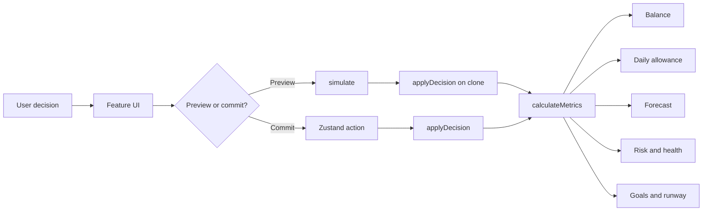

# Architecture

RupeePulse uses a feature-first React architecture with a pure finance domain at its centre. UI modules never calculate their own financial truth: every surface consumes `calculateMetrics`, and every hypothetical choice uses `simulate` before it can reach the store.

## Module boundaries

| Layer | Responsibility | Mutation policy |
| --- | --- | --- |
| `engine/` | Pure calculations, decisions, forecast and deterministic time | Clones input; no UI or storage access |
| `store/` | Confirmed state, undo, reset, persistence and notifications | Only authorised mutation boundary |
| `features/` | Today, simulator, forecast, plans and their local interaction state | Calls engine/store; no duplicated formulas |
| `components/` | Reusable layout, chart and financial visual primitives | Presentational |
| `app/` | Navigation contracts | Static configuration |

## Loading strategy

Today is part of the initial bundle because it is the first meaningful screen. Simulator, Forecast, and Plans load on demand through `React.lazy`. The forecast renderer is a small native SVG component rather than a chart runtime. Below-fold dashboard panels use `content-visibility: auto`.

## State guarantees

- Simulation clones the current state and cannot change the live balance.
- Confirmed actions pass through one store command and create a recoverable undo snapshot.
- Inputs are bounded and normalised in both the interface and engine.
- Advancing a day settles each unpaid scheduled item exactly once.
- Persistence is client-only and contains no credentials or banking identifiers.
